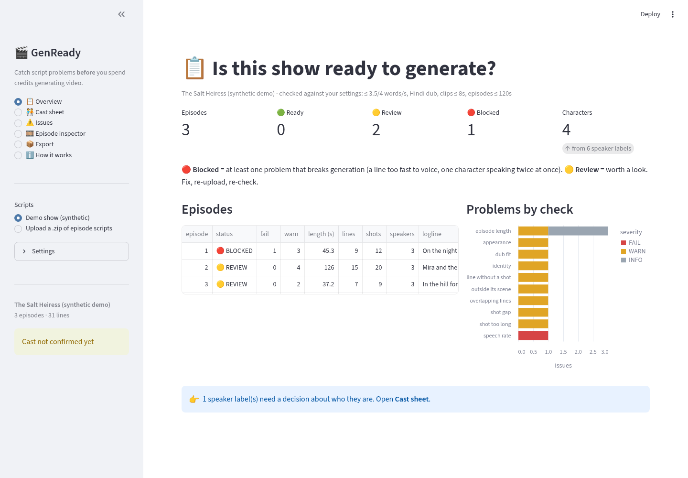
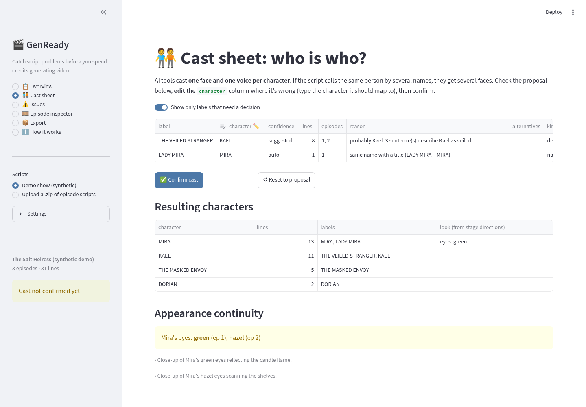
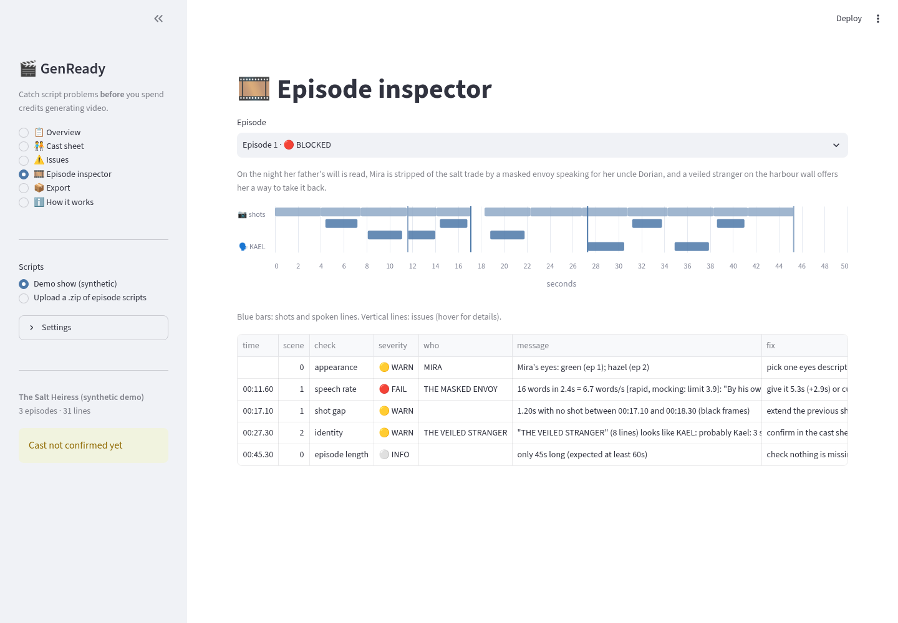

# GenReady: script QA before AI generation

**Kuku AI Generalist assignment, Problem 3 ("find your own problem")**, Deepti Rani Panda

An AI microdrama is made line by line: a face for each character, a voice for each line, a video clip for each
shot. Generation is the slow, paid step. Many of the things that go wrong there are already visible in the script:

- **One character, several names**: "LADY MIRA" vs "MIRA", or "THE VEILED STRANGER" until the reveal and "KAEL"
  after it. Each label gets cast separately, so the hero gets two faces and two voices.
- **Look drift**: "green eyes" in ep 1, "hazel eyes" in ep 2. Image models take that literally.
- **Lines too fast for their slot**: 16 words in 2.4 s gets rushed or clipped by the voice model, and gets worse
  after dubbing.
- **Shot problems**: holes with no shot (black frames), lines no shot covers, shots longer than one AI clip, two
  voices at once.

GenReady reads the episode scripts, flags these problems with a suggested fix, has a **person confirm the cast
sheet**, and exports the cleaned files for the generation step.

**Who it's for:** the AI production operator, between "script locked" and "start generating".

## Run it

```bash
pip install -r requirements.txt
streamlit run app.py                    # web app: demo show built in, or upload a zip of scripts
python run_qa.py demo_show -o out       # CLI on a folder or a .zip
python run_qa.py scripts.zip -o out --dub Spanish --max-clip 6 --no-script
python -m pytest -q                     # 11 tests
```

Deploy on Streamlit Community Cloud: point it at this repo with `app.py` as the main file. No secrets and no API
keys are needed.

**Input format:** the timestamped screenplay format (`EPISODE NUMBER / EPISODE LOGLINE / CONTINUITY NOTES`,
`SCENE NN` blocks, then `**CAMERA:**`, `**ACTION:**`, `**SOUND FX:**`, `**NAME (Tone):**` events, each followed by
`Start: (MM:SS.cc) | End: (MM:SS.cc)`). One `.txt` per episode.

The public repo ships only a **synthetic** demo show (`demo_show/`, generated by `demo_show/make_demo.py`).
No real show scripts are included.

## The app
| Page | What you do there |
|---|---|
| Overview | READY / REVIEW / BLOCKED per episode, and problems by type |
| Cast sheet | Check the proposed label → character mapping, fix the `character` column, **Confirm cast** |
| Issues | Filter every finding by severity, check or episode; each one has a suggested fix |
| Episode inspector | Timeline of shots and lines per character, with issues marked |
| Export | `issues.csv`, `episodes.csv`, `cast_map.json`, `cast_sheet.json`, `normalized_script.json` |

The sidebar settings match the operator's tools: voice speed limits, the dub language, the video model's longest
clip, and the maximum episode length.

## Code map
- `genready/parse.py`: script → episodes, scenes and timed events (also reads an uploaded zip in memory)
- `genready/cast.py`: speaker labels → proposed characters, with evidence; eye and hair colour continuity
- `genready/checks.py`: speech rate, dub fit, overlaps, shots, structure; `Settings` holds every threshold
- `genready/report.py`: runs everything, gives each episode a status, writes the exports
- `app.py`: the Streamlit UI · `run_qa.py`: the CLI · `docs/DESIGN.md`: decisions, assumptions, limits

## Screenshots (synthetic demo show)



